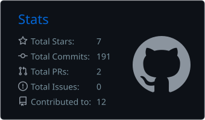
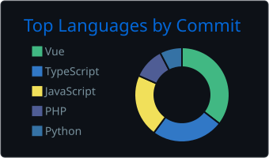

<!-- ===================== HEADER ===================== -->
<p align="center">
  
</p>

<p align="center">
  <a href="https://github.com/Laloka2000">
    
  </a>
</p>

<p align="center">
  <a href="https://www.linkedin.com/in/YOUR-LINKEDIN/"></a>
  <a href="mailto:YOUR.EMAIL@gmail.com"></a>
  
</p>

---

### 🧑‍💻 About me

```js
const laci = {
  location:  "Hungary 🇭🇺",
  role:      "Full-Stack Developer",
  daily:     ["PHP", "Laravel", "REST APIs", "MySQL", "Vue.js"],
  sideQuest: ["React", "TypeScript", "Node.js"],
  learning:  "Computer Science BSc @ University of Szeged",
  funFact:   "I have more VS Code extensions than I should 🥲",
};
```

- 🎣 Built the backend of **FishMap**, a mobile app for anglers — sharing, 1:1 chat, live activity, and a lot of slow-endpoint optimization
- 🌐 Shipped Laravel + Vue.js web apps and WordPress / WooCommerce sites for clients
- 🌱 Currently leveling up in React, TypeScript and CS fundamentals

---

### 🛠️ Tech stack

<p align="center">
  <br/>
  <br/>
  
</p>

---

### 🚀 Featured projects

<table>
  <tr>
    <td width="50%" valign="top">
      <h3>📈 <a href="https://github.com/Laloka2000/tech-stock-watcher">TechPulse</a></h3>
      <p>Real-time tech stock watchlist &amp; portfolio tracker, installable as a PWA. Live quotes, candlestick charts, sparklines and company fundamentals.</p>
      <p>
        
        
        
        
      </p>
      <a href="https://tech-stock-watcher.vercel.app">🔗 Live demo</a> · <a href="https://github.com/Laloka2000/tech-stock-watcher">💻 Code</a>
    </td>
    <td width="50%" valign="top">
      <h3>🧑‍🎨 <a href="https://github.com/Laloka2000/laszlo-lelovics-new-portfolio">Portfolio</a></h3>
      <p>My personal portfolio site — who I am, what I build, and how to reach me.</p>
      <p>
        
        
      </p>
      <a href="https://github.com/Laloka2000/laszlo-lelovics-new-portfolio">💻 Code</a>
    </td>
  </tr>
</table>

---

### 📊 GitHub stats

<p align="center">
  
  
</p>

<p align="center">
  
</p>

<!-- ===================== FOOTER ===================== -->
<p align="center">
  
</p>
